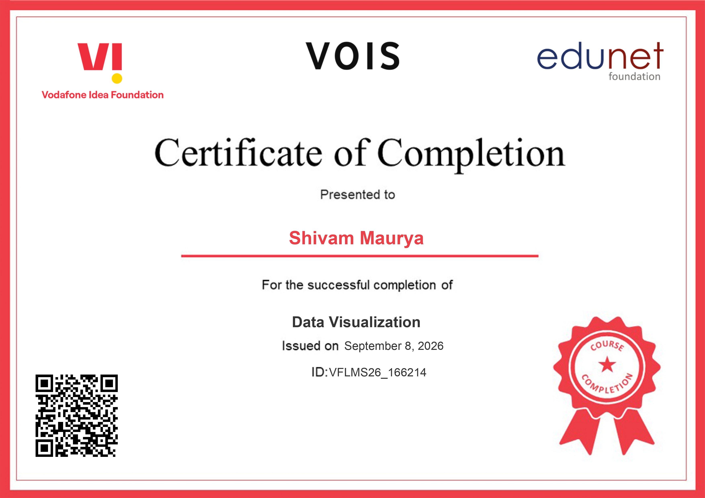

# 🏥 Healthcare Analytics for Doctor Visits: An Exploratory Data Analysis

[](https://www.python.org/)
[](https://jupyter.org/)
[](https://pandas.pydata.org/)
[](https://numpy.org/)
[](https://seaborn.pydata.org/)
[](LICENSE)

> **VOIS DIY Project Submission | TIRTC**  
> **Course Track:** Data Visualization  
> **Author:** Shivam Maurya  
> **AICTE Student ID:** `STU69ef58f1ec3ba1777293553`  
> **Institution:** Arya College of Engineering  

---

## 📑 Table of Contents
- [📌 Project Overview](#-project-overview)
- [🎯 Problem Statement](#-problem-statement)
- [📊 Dataset Architecture & Data Dictionary](#-dataset-architecture--data-dictionary)
- [🔬 Analytical Pipeline & Methodology](#-analytical-pipeline--methodology)
- [📈 Key Analysis & Visualizations](#-key-analysis--visualizations)
- [💡 Breakthrough Findings & Core Insights](#-breakthrough-findings--core-insights)
- [👥 End Users & Stakeholder Applications](#-end-users--stakeholder-applications)
- [📂 Repository Structure](#-repository-structure)
- [🚀 Getting Started & Execution Guide](#-getting-started--execution-guide)
- [🔮 Future Scope & Roadmap](#-future-scope--roadmap)
- [📜 Certification & Credentials](#-certification--credentials)
- [📄 License](#-license)

---

## 📌 Project Overview

Healthcare systems globally face severe challenges in allocating resources, managing clinical capacity, and proactively identifying vulnerable patient cohorts. This project delivers an in-depth **Exploratory Data Analysis (EDA)** and statistical utilization modeling on a comprehensive healthcare dataset of **5,190 patient records**.

Developed as part of the **_VOIS DIY Project** under **TIRTC**, this repository investigates how socioeconomic determinants (income, gender), health indicators (illness count, chronic conditions, activity limitation days), and public/private insurance safety nets interact to drive the frequency of outpatient doctor visits.

---

## 🎯 Problem Statement

Healthcare administrators and public health planners often operate reactively because they lack empirical visibility into what drives clinical demand. 

Key research questions tackled in this study:
1. **Demand Drivers:** What is the strongest predictor of outpatient doctor visits?
2. **The "Missing Middle":** How effectively do government health subsidies cover vulnerable populations, and what proportion remains unprotected?
3. **Gender Disparities:** Do health dips produce unequal productivity loss across genders?
4. **Income Inelasticity:** Does personal income level directly govern whether a sick patient seeks medical attention?

---

## 📊 Dataset Architecture & Data Dictionary

The project utilizes the `Healthcare Analytics for Doctor Visits.csv` dataset, comprising **5,190 records** across **13 attributes** with zero missing values (100% data completeness).

| Column Name | Category | Data Type | Description | Values / Range |
|:---|:---|:---:|:---|:---|
| `Unnamed: 0` | Identifier | Integer | Row index / record identifier | `1` to `5190` |
| `visits` | Target Metric | Integer | Number of doctor visits within the survey period | Discrete (`0`, `1`, `2`, `...`, `9`) |
| `gender` | Demographic | String | Biological gender of the patient | `female`, `male` |
| `age` | Demographic | Float | Patient age represented in standardized decimal format | `0.19` to `0.72` |
| `income` | Financial | Float | Standardized household income score | `0.0` to `1.5` |
| `illness` | Health Metric | Integer | Number of active illnesses or acute medical complaints | `0`, `1`, `2`, `3`, `4`, `5` |
| `reduced` | Health Impact | Integer | Number of days normal daily activities were reduced due to illness | `0` to `14` days |
| `health` | Health Metric | Integer | General health score indicator | Standardized integer scale |
| `private` | Insurance | String | Enrolled in private health insurance coverage | `yes`, `no` |
| `freepoor` | Safety Net | String | Government-subsidized free healthcare due to low income | `yes`, `no` |
| `freerepat` | Safety Net | String | Free healthcare via old age, disability, or repatriation/veteran status | `yes`, `no` |
| `nchronic` | Clinical | String | Presence of a non-chronic medical condition | `yes`, `no` |
| `lchronic` | Clinical | String | Presence of a long-term chronic condition limiting activities | `yes`, `no` |

### Attribute Categorization
- **Demographic Information:** `gender`, `age`
- **Socioeconomic Indicators:** `income`
- **Clinical Health Status:** `illness`, `health`, `reduced`, `nchronic`, `lchronic`
- **Insurance & Safety Nets:** `private`, `freepoor`, `freerepat`
- **Outcome Variable:** `visits`

---

## 🔬 Analytical Pipeline & Methodology

```
┌────────────────────────────────────────────────────────┐
│                   1. DATA QUALITY AUDIT                │
│  Null Check (Heatmap) • Memory Footprint • Types Scan  │
└───────────────────────────┬────────────────────────────┘
                            │
┌───────────────────────────▼────────────────────────────┐
│                2. STATISTICAL DISTRIBUTIONS            │
│  Demographics • Income Boxplots • Illness Frequencies  │
└───────────────────────────┬────────────────────────────┘
                            │
┌───────────────────────────▼────────────────────────────┐
│              3. BIVARIATE & MULTIVARIATE EDA           │
│   Income vs. Visits • Gender vs. Reduced Days Impact   │
└───────────────────────────┬────────────────────────────┘
                            │
┌───────────────────────────▼────────────────────────────┐
│             4. POLICY & SAFETY NET ANALYSIS            │
│   Pie Chart Distributions • "Missing Middle" Exposure  │
└───────────────────────────┬────────────────────────────┘
                            │
┌───────────────────────────▼────────────────────────────┐
│            5. STRATEGIC SYNTHESIS & REPORTING          │
│   Actionable Takeaways • Presentation Deck • Roadmap   │
└────────────────────────────────────────────────────────┘
```

The analytical workflow was structured across three rigorous stages:
1. **Phase 1: Exploratory Data Analysis & Integrity Audit**
   - Verified 100% data completeness with `df.isnull().sum()` and a Seaborn heatmap.
   - Profiled statistical dispersion (`df.describe()`) and structural memory usage (`df.info()`).
2. **Phase 2: Multivariate & Cross-Segment Analysis**
   - Constructed correlation heatmaps to detect multi-collinearity and linear dependencies.
   - Evaluated the interaction between chronic health conditions, active illness counts, and medical visits.
3. **Phase 3: Socioeconomic Safety Net Evaluation**
   - Quantified proportions of government-assisted vs. privately insured cohorts to uncover healthcare accessibility bottlenecks.

---

## 📈 Key Analysis & Visualizations

The Jupyter Notebook (`Healthcare_Analytics_for_Doctor_Visits.ipynb`) conducts 11 targeted analytical experiments:

### 1. Dataset Ingestion & Dimension Verification
- Loaded the 5,190-row dataset and verified schema headers, tail entries, and data distributions.

### 2. Structural & Memory Profiling
- Ingested clean data without missing fields, examining integer and float conversions for downstream analytics.

### 3. Patient Illness Count Distribution
- Analyzed illness counts: 
  - `0 illnesses`: 1,554 individuals
  - `1 illness`: 1,638 individuals
  - `2 illnesses`: 946 individuals
  - `3 illnesses`: 542 individuals
  - `4 illnesses`: 274 individuals
  - `5 illnesses`: 236 individuals

### 4. Income Dispersion & Outlier Analysis
- Utilized boxplots to examine income distribution, highlighting median earning benchmarks and right-skewed high-income outliers.

### 5. Gender-Based Functional Activity Reduction
- Computed mean days of reduced physical activity grouped by gender and illness status.
- **Result:** Females experience higher overall functional limitation (average **0.98 days**) compared to males (**0.74 days**).

### 6. Missing Value Heatmap Verification
- Plotted an un-annotated binary Seaborn heatmap (`sns.heatmap(df.isnull())`) to visually validate that zero null or corrupted cells exist.

### 7. Correlation Matrix Heatmap
- Constructed a Pearson correlation matrix showing strong positive associations between `illness`, `reduced`, `health`, and doctor `visits`.

### 8. Income Level vs. Healthcare Utilization
- Plotted scatter visualizations mapping income scores against hospital visit counts.
- **Finding:** Sickness-driven demand is relatively inelastic; individuals with acute illness visit doctors regardless of income bracket.

### 9. Demographic Split of Affected Patients
- Visualized male (`2,488`) vs. female (`2,702`) representation across illness tiers.

### 10. Healthcare Safety Net & Insurance Distributions
- Subplot pie charts evaluating coverage proportions:
  - **Free Government Care (Low Income - `freepoor`):** ~10.1% Yes / 89.9% No
  - **Free Government Care (Elderly/Disability - `freerepat`):** ~21.0% Yes / 79.0% No
  - **Private Insurance Coverage (`private`):** ~44.3% Yes / 55.7% No

### 11. Activity Limitation Visual Comparisons
- Plotted horizontal bar charts and boxplots comparing reduced activity days and visit counts across demographic groups.

---

## 💡 Breakthrough Findings & Core Insights

### 1. 🛡️ The "Missing Middle" Insurance Gap
While **10.1%** of citizens receive subsidized care through low-income government programs (`freepoor`) and **21.0%** qualify via old age, veteran status, or disability (`freerepat`), over **55.7%** of the population lacks private insurance. This exposes a massive *"missing middle"*—working individuals who earn just above the poverty threshold but cannot afford private insurance, leaving them vulnerable to out-of-pocket medical expenses.

### 2. ⚡ Illness-to-Visit Elasticity
Outpatient doctor visits exhibit a steep, monotonic increase directly correlated with illness severity:
- **0 Illnesses:** Average of **0.08 visits**
- **1 Illness:** Average of **0.30 visits**
- **3 Illnesses:** Average of **0.42 visits**
- **5 Illnesses:** Average jumps to **0.81 visits** (over **10x higher** than healthy individuals)

### 3. 👩‍⚕️ Gender-Based Productivity Vulnerability
Health impairments lead to disproportionate functional losses for women. On average, females suffered **0.98 days** of reduced normal activity per period compared to **0.74 days** for males—a **32.4% increase** in sickness-induced downtime.

---

## 👥 End Users & Stakeholder Applications

| Stakeholder | Practical Use Case | Primary Benefit |
|:---|:---|:---|
| **Hospital Administrators** | Capacity & Staffing Planning | Predict clinical bed capacity and doctor shifts based on incoming illness severity metrics. |
| **Public Health Policymakers** | Safety Net Restructuring | Recalibrate qualification thresholds for `freepoor` programs to cover the unprotected "missing middle". |
| **Health Insurance Providers** | Risk Stratification & Premium Modeling | Design micro-insurance products tailored to moderate-income earners with non-chronic illness risks. |
| **Corporate HR & Wellness** | Occupational Health Policies | Implement gender-informed wellness and ergonomic support programs to mitigate lost productivity days. |

---

## 📂 Repository Structure

```
vois-x-tirtc/
├── 📄 Healthcare Analytics for Doctor Visits.csv     # Master dataset (5,190 patient records, 13 features)
├── 📓 Healthcare_Analytics_for_Doctor_Visits.ipynb   # Complete Jupyter Notebook with 11 analysis steps & plots
├── 📝 Dataset explanation.docx                       # Comprehensive dataset reference guide
├── 📊 VOIS_DIY_Project_PPT_Submission_TIRTC.pptx    # Executive presentation slide deck (15 slides)
├── 📜 Shivam_Maurya_Data_Visualization_VOIS_page-0001.jpg # Course completion certificate (Data Visualization)
├── 📑 LICENSE                                        # MIT Open-Source License
├── 🙈 .gitignore                                     # Git ignore rules for notebooks and caches
└── 📖 README.md                                      # Project documentation & analysis report
```

---

## 🚀 Getting Started & Execution Guide

### Prerequisites
Make sure you have Python 3.8+ installed on your system.

### 1. Clone the Repository
```bash
git clone https://github.com/scriptedbyshivam/vois-x-tirtc.git
cd vois-x-tirtc
```

### 2. Set Up a Virtual Environment (Recommended)
```bash
# Windows
python -m venv venv
venv\Scripts\activate

# Linux / macOS
python3 -m venv venv
source venv/bin/activate
```

### 3. Install Dependencies
```bash
pip install pandas numpy matplotlib seaborn jupyter
```

### 4. Launch Jupyter Notebook
```bash
jupyter notebook Healthcare_Analytics_for_Doctor_Visits.ipynb
```
*(Or open the file directly in Visual Studio Code / Google Colaboratory).*

---

## 🔮 Future Scope & Roadmap

- [ ] **Count Regression Modeling:** Deploy **Poisson Regression** and **Negative Binomial Models** specifically tailored for non-negative, right-skewed discrete count distributions (`visits`).
- [ ] **Machine Learning Benchmarking:** Train Random Forest and XGBoost Regressors with cross-validation to predict appointment loads.
- [ ] **No-Show & Readmission Risk Classification:** Integrate longitudinal patient appointment histories to flag high-risk no-shows.
- [ ] **IoT & Wearable Health Integration:** Connect real-time biometric telemetry (heart rate, step cadence, sleep quality) to model functional impairment dynamically.
- [ ] **Interactive Dashboard:** Build an interactive **Streamlit** or **PowerBI** executive dashboard for real-time scenario simulation.

---

## 📜 Certification & Credentials

This project fulfills the requirements for the **Data Visualization** track conducted by **Vodafone Intelligent Solutions (_VOIS)** in partnership with **TIRTC**.



- **Student:** Shivam Maurya
- **AICTE Student ID:** `STU69ef58f1ec3ba1777293553`
- **Institution:** Arya College of Engineering
- **Program:** _VOIS DIY Project Submission (TIRTC)

---

## 📄 License

This repository is distributed under the terms of the **MIT License**. See the [LICENSE](LICENSE) file for full details.

---

<p align="center">
  <b>Developed with ❤️ by <a href="https://github.com/scriptedbyshivam">Shivam Maurya</a></b><br>
  <i>Empowering Healthcare Decision-Making through Data Science & Visualization</i>
</p>
